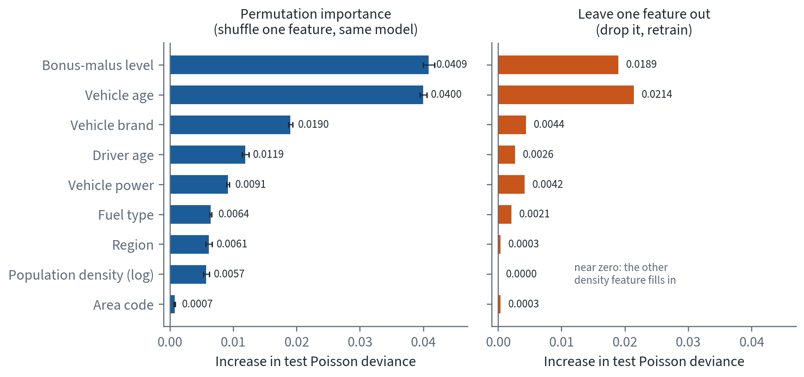
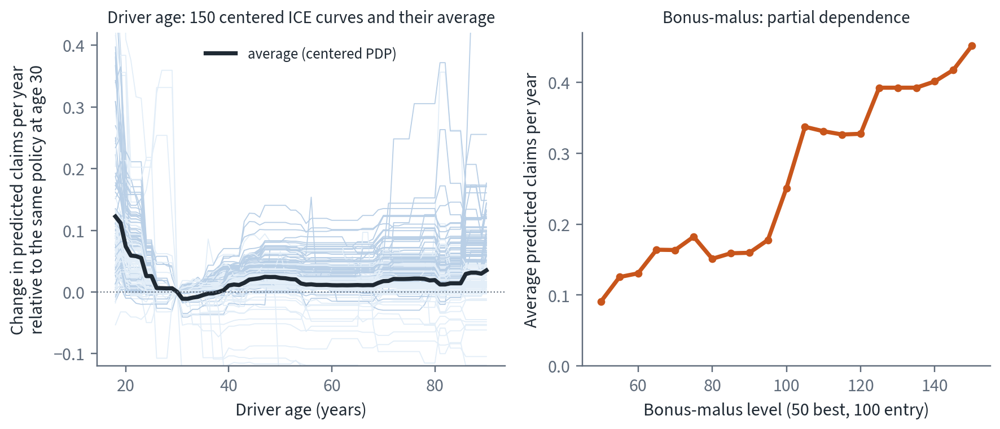
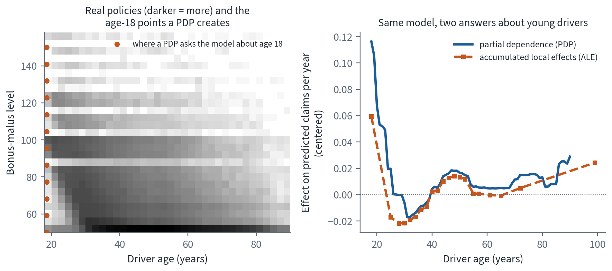
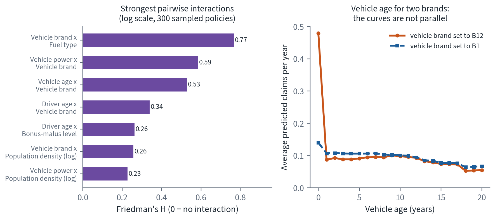
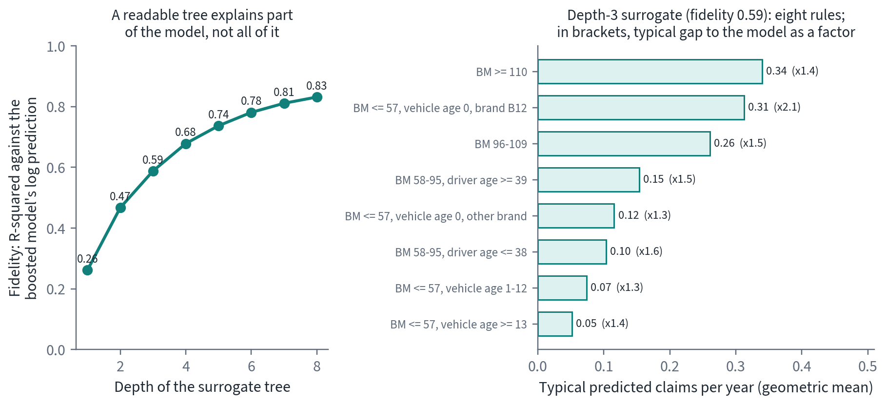

# Global Explanation: Motor Claims Frequency Model (practice document for Lab 6.1)

*Written for a teaching exercise. Some of its statements are deliberately wrong or overstated. Your job is to find them.*

## 1. Model and data

Gradient-boosted tree ensemble with a Poisson loss (scikit-learn HistGradientBoostingRegressor, 31 leaves per tree, early stopping), trained on two thirds of the freMTPL2freq policies and tested on the remaining third (223,745 policies). Target: claims per policy-year, with exposure as weight. Test Poisson deviance: **0.571** for the model, **0.622** for a single rate for everyone.

## 2. Importance

| Feature | Permutation importance (increase in test deviance, mean of 5) | Spread (sd) | Leave one feature out (retrain) |
|---|---|---|---|
| Bonus-malus level | 0.0409 | 0.0009 | 0.0189 |
| Vehicle age | 0.0400 | 0.0005 | 0.0214 |
| Vehicle brand | 0.0190 | 0.0003 | 0.0044 |
| Driver age | 0.0119 | 0.0005 | 0.0026 |
| Vehicle power | 0.0091 | 0.0002 | 0.0042 |
| Fuel type | 0.0064 | 0.0002 | 0.0021 |
| Region | 0.0061 | 0.0005 | 0.0003 |
| Population density (log) | 0.0057 | 0.0005 | 0.0000 |
| Area code | 0.0007 | 0.0001 | 0.0003 |

Area code and population density together: permutation 0.0054, drop both and retrain 0.0011. A crosstab shows that each area code covers a narrow band of population density.

## 3. Shape of the main effects

Partial dependence on bonus-malus (2,000 test policies): 0.091 claims per year at level 50, 0.251 at 100, 0.452 at 150. Partial dependence on driver age: 0.231 at 18, 0.108 at 30, 0.131 at 50, 0.128 at 80. Centered ICE curves at age 18 (relative to the same policy at 30): 10th percentile +0.011, median +0.081, 90th percentile +0.247.

Driver age and bonus-malus are correlated (-0.48). Of 11,253 drivers aged 18 to 21, 4.7 percent have bonus-malus 60 or below. ALE for driver age at 18: +0.059; PDP (centered) at 18: +0.116.

## 4. Interactions

Friedman's H on the log scale, 300 sampled policies: brand x fuel 0.77, power x brand 0.59, vehicle age x brand 0.53, driver age x brand 0.34, driver age x bonus-malus 0.26. In the data, 37,069 of the 166,024 brand B12 policies are first-year vehicles, with mean exposure 0.26 years and 0.45 claims per policy-year (0.08 for older B12 vehicles, 0.09 for all other policies). Joint partial dependence at vehicle age 0: 0.48 with brand set to B12, 0.14 with brand set to B1.

## 5. Surrogate

Decision trees fitted to the model's log predictions. Fidelity (R-squared on test policies) by depth: 0.26, 0.47, 0.59, 0.68, 0.74, 0.78, 0.81, 0.83. The depth-3 tree's loosest leaf is new B12 vehicles at the bonus-malus floor (typical gap to the model: a factor of 2.1); the tightest is new vehicles of other brands at the floor (factor 1.3).

## 6. Executive summary (as drafted by the author of this document)

The model is driven by bonus-malus and vehicle age. Young drivers cause far more claims, and the effect of being 18 is about +0.12 claims per year. Population density does not matter and can be removed. B12 cars are dangerous. The depth-3 tree explains how the model works and can be used for rate filing.

## 7. Statements to assess

1. Bonus-malus and vehicle age are the two features the fitted model relies on most.
2. Being 18 causes about 0.12 extra claims per year.
3. The young-driver effect differs a lot between policies.
4. Population density can be removed from the rating plan with no loss.
5. Area code and population density carry largely the same information.
6. B12 cars are more dangerous than other brands.
7. The model has learned a strong pattern for new B12 vehicles that the data owners should explain.
8. The depth-3 surrogate reproduces a little more than half of the variation in the model's log predictions.
9. The depth-3 surrogate is accurate enough to replace the model in a rate filing.
10. The H value for driver age and bonus-malus may be inflated by extrapolation.
